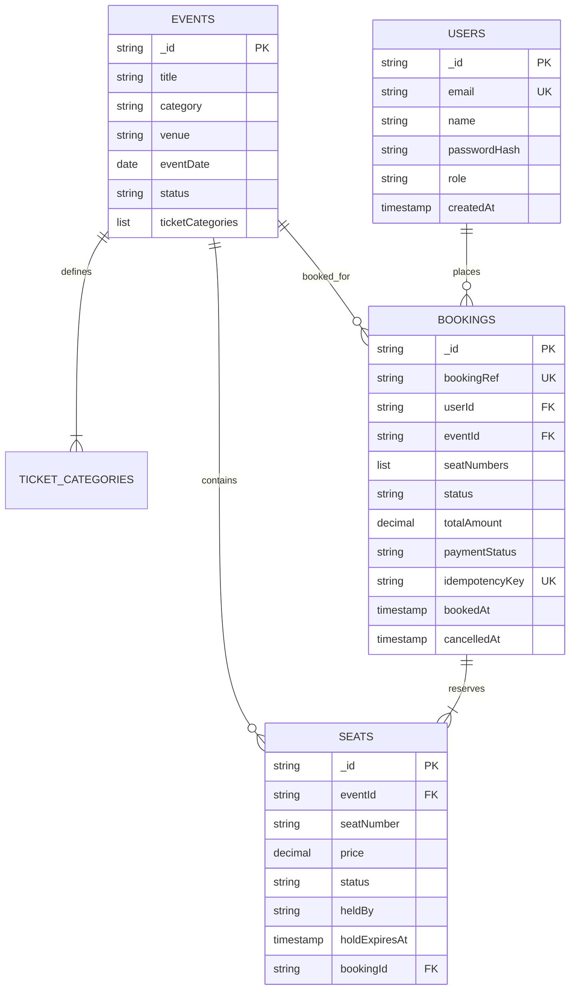

# Database Schema & Architecture Design Document

**System:** Event Ticket Booking & Reservation System  
**Database:** MongoDB 7.0+ (Replica Set / MongoDB Atlas)  
**Object-Document Mapper:** Spring Data MongoDB (Java 21)

---

## 1. Architectural Philosophy: Embedding vs. Referencing

In MongoDB schema architecture, deciding between embedded documents and referenced documents is based on access patterns, document size limits (16MB), and transaction isolation requirements.

| Relationship | Design Decision | Justification |
| :--- | :--- | :--- |
| **Event $\rightarrow$ TicketCategories** | **Embedded** | Categories (VIP, Premium, General) are bounded (typically 2–5 per event), always read together with the event details, and rarely exceed 1 KB. |
| **Event $\rightarrow$ Seats** | **Referenced Collection** | An event can have hundreds to thousands of seats. Embedding seats inside the Event document would risk hitting the 16MB limit, cause massive document growth (memory fragmentation), and create concurrent write lock contention when multiple users update seats. Separating into `seats` allows atomic `findAndModify` per seat document. |
| **User $\rightarrow$ Bookings** | **Referenced Collection** | A user can accumulate hundreds of bookings over time (unbounded growth). Bookings are referenced via `userId`. |
| **Booking $\rightarrow$ Seats** | **Referenced by Array** | The `Booking` document stores an array of seat identifier strings (`seatNumbers: ["VIP-1", "VIP-2"]`), keeping documents lean while preserving audit trails. |

---

## 2. Collection Specifications

### 2.1 Collection: `users`

Stores customer and administrator identity records. Passwords are never stored in plaintext and are hashed using BCrypt (10 rounds).

```json
{
  "_id": "6ae2c59327bdbd4cf4154831",
  "name": "Alex Morgan",
  "email": "user@ticketbooking.com",
  "passwordHash": "$2a$10$Wq6mJ5zYkK7H2iBq0lRz1u.bEKnT3qR7QnS1mG9H5v6P8x7c1a",
  "role": "ROLE_USER",
  "createdAt": ISODate("2026-10-29T04:00:00Z"),
  "updatedAt": ISODate("2026-10-29T04:00:00Z")
}
```

#### Indexes:
- `{ email: 1 }` (**UNIQUE**): Enforces email uniqueness across the entire system. Case-normalized to lowercase before persistence.

---

### 2.2 Collection: `events`

Stores published and scheduled entertainment events with venue and pricing details.

```json
{
  "_id": "6ae2c59327bdbd4cf4154832",
  "title": "Coldplay: Music of the Spheres World Tour",
  "description": "Live stadium performance featuring cosmic lights and orchestral music.",
  "category": "CONCERT",
  "venue": "Wembley Arena Stadium",
  "location": "London, UK",
  "eventDate": "2026-11-12",
  "startTime": "19:30",
  "endTime": "23:00",
  "status": "PUBLISHED",
  "bannerUrl": "https://images.unsplash.com/photo-1470225620780-dba8ba36b745",
  "ticketCategories": [
    {
      "categoryCode": "VIP",
      "categoryName": "VIP Diamond Lounge",
      "price": NumberDecimal("250.00"),
      "totalSeats": 12
    },
    {
      "categoryCode": "PREMIUM",
      "categoryName": "Premium Reserved",
      "price": NumberDecimal("140.00"),
      "totalSeats": 20
    },
    {
      "categoryCode": "GENERAL",
      "categoryName": "General Admission",
      "price": NumberDecimal("75.00"),
      "totalSeats": 30
    }
  ],
  "createdAt": ISODate("2026-10-29T04:00:00Z"),
  "updatedAt": ISODate("2026-10-29T04:00:00Z")
}
```

#### Indexes:
- `{ status: 1, eventDate: 1 }` (**COMPOUND**): Supports the primary discovery query (`status = 'PUBLISHED' AND eventDate >= today`). Uses the Equality-Sort-Range (ESR) index design rule.

---

### 2.3 Collection: `seats`

Stores granular inventory records per seat for each event. Facilitates atomic reservation and lock prevention.

```json
{
  "_id": "6ae2c59327bdbd4cf4154833",
  "eventId": "6ae2c59327bdbd4cf4154832",
  "seatNumber": "VIP-1",
  "categoryCode": "VIP",
  "price": NumberDecimal("250.00"),
  "status": "BOOKED",
  "heldBy": null,
  "holdExpiresAt": null,
  "bookingId": "BK-9B4F81A2",
  "createdAt": ISODate("2026-10-29T04:00:00Z"),
  "updatedAt": ISODate("2026-10-29T04:05:00Z")
}
```

#### Status Lifecycle:
$$\text{AVAILABLE} \xrightarrow{\text{holdSeats()}} \text{HELD (heldBy, holdExpiresAt)} \xrightarrow{\text{createBooking()}} \text{BOOKED (bookingId)}$$
$$\text{HELD} \xrightarrow{\text{timer expired / cleanup}} \text{AVAILABLE}$$
$$\text{BOOKED} \xrightarrow{\text{cancelBooking()}} \text{AVAILABLE}$$

#### Indexes:
- `{ eventId: 1, seatNumber: 1 }` (**UNIQUE COMPOUND**): Prevents duplicate seats for any event at the database engine level.
- `{ eventId: 1, status: 1 }` (**COMPOUND**): Optimizes available seat inventory queries and seat grid rendering.

---

### 2.4 Collection: `bookings`

Stores immutable financial order records and historical reservations.

```json
{
  "_id": "6ae2c59327bdbd4cf4154834",
  "bookingRef": "BK-9B4F81A2",
  "userId": "6ae2c59327bdbd4cf4154831",
  "userEmail": "user@ticketbooking.com",
  "userName": "Alex Morgan",
  "eventId": "6ae2c59327bdbd4cf4154832",
  "eventTitle": "Coldplay: Music of the Spheres World Tour",
  "eventCategory": "CONCERT",
  "seatNumbers": ["VIP-1", "VIP-2"],
  "status": "CONFIRMED",
  "totalAmount": NumberDecimal("500.00"),
  "paymentStatus": "MOCK_PAID",
  "idempotencyKey": "PAY-coldplay-user1-VIP1-VIP2-1793246",
  "bookedAt": ISODate("2026-10-29T04:05:00Z"),
  "cancelledAt": null,
  "createdAt": ISODate("2026-10-29T04:05:00Z"),
  "updatedAt": ISODate("2026-10-29T04:05:00Z")
}
```

#### Indexes:
- `{ bookingRef: 1 }` (**UNIQUE**): Point-lookup index for ticket inspection and verification.
- `{ userId: 1, bookedAt: -1 }` (**COMPOUND**): Optimizes "My Bookings" user query sorted in descending chronological order.
- `{ eventId: 1, status: 1 }` (**COMPOUND**): Optimizes event revenue and ticket sales aggregation.
- `{ idempotencyKey: 1 }` (**UNIQUE, SPARSE**): Rejects duplicate submissions from client retries or network replays.

---

## 3. Entity-Relationship Model (Mermaid Diagram)



