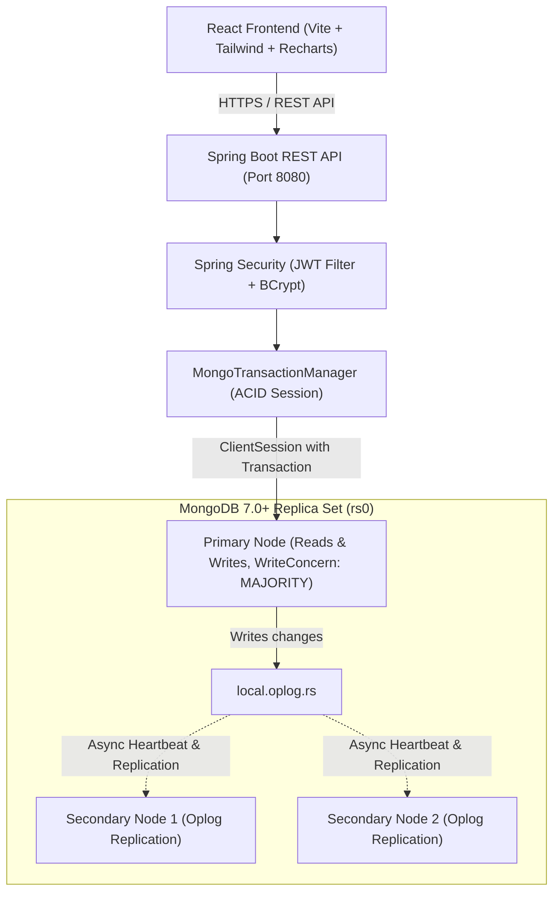
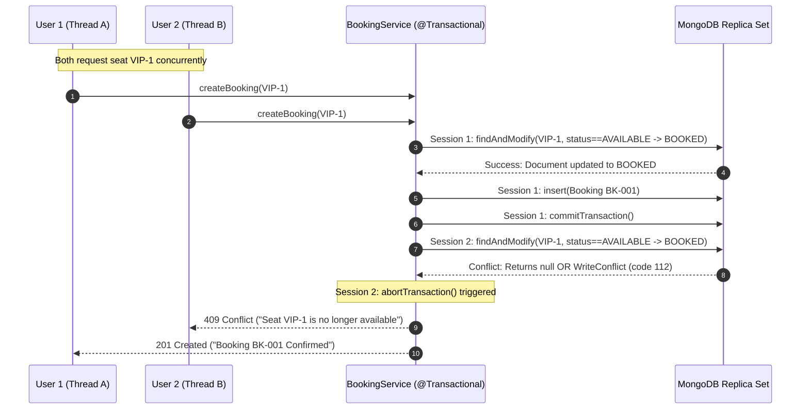

# College Final Project Report: Event Ticket Booking & Reservation System Using MongoDB

---

## 1. Title Page

**Project Title:** Event Ticket Booking & Reservation System Using MongoDB  
**Academic Degree:** Bachelor of Technology / Bachelor of Science in Computer Science & Engineering  
**Subject:** Advanced Database Management Systems / NoSQL Databases (MongoDB Syllabus)  
**Author:** Final Year Project Team  
**Institution:** Department of Computer Science & Engineering  
**Academic Year:** 2025–2026  

---

## 2. Abstract

The **Event Ticket Booking & Reservation System** is an enterprise-grade full-stack web application designed to demonstrate the practical application of MongoDB in high-concurrency, transactional workloads. While traditional online reservation platforms have historically relied on Relational Database Management Systems (RDBMS) for ACID compliance, modern document databases like MongoDB offer multi-document ACID transactions, horizontal sharding capabilities, flexible document models, and advanced aggregation frameworks. 

This project addresses the critical challenge of **preventing concurrent seat overbooking** using conditional atomic updates (`findAndModify`), temporary reservation holds with automatic expiration, and multi-document transactions with `WriteConcern.MAJORITY`. The application incorporates a high-performance **Java 21 LTS / Spring Boot 3.4** backend, an interactive **React + Vite + Tailwind CSS** frontend with SVG seat maps, and an administrative analytics suite driven by real-time MongoDB aggregation pipelines (`$match`, `$group`, `$project`, `$sort`, `$unwind`). Comprehensive query diagnostics, explain-plan comparisons (`IXSCAN` vs. `COLLSCAN`), automated backup/recovery runbooks, and a 13-test automated test suite confirm the system's architectural integrity and performance.

---

## 3. Introduction

Ticketing and reservation platforms (such as Ticketmaster, BookMyShow, and Eventbrite) require stringent correctness guarantees. Thousands of concurrent users frequently compete for identical premium seating within milliseconds of an event going live. In this environment, database race conditions, phantom reads, and lost updates can cause catastrophic double-bookings, customer dissatisfaction, and financial liabilities.

Historically, academic curricula have taught database transactions exclusively through relational systems. However, MongoDB 4.0+ introduced multi-document ACID transactions across replica sets, bridging the gap between flexible NoSQL document storage and enterprise transactional integrity. This project bridges theory and practice by providing a fully working, reproducible system adhering strictly to the university MongoDB syllabus.

---

## 4. Problem Statement

Building an event ticketing system on a NoSQL database presents several distinct architectural hurdles:
1. **Concurrency Control:** Ensuring two users clicking "Book Seat A1" simultaneously never both receive confirmation.
2. **Temporary Reservation Holds:** Permitting users to hold seats for 10 minutes during checkout without permanently locking out inventory if the customer abandons the cart.
3. **Multi-Document Consistency:** Maintaining consistency across separate `seats` and `bookings` collections when reservations are created or cancelled.
4. **Complex Sales Aggregations:** Accurately calculating event-wise ticket sales, occupancy rates, and revenue while strictly excluding cancelled or pending transactions.
5. **Database Diagnostics & Optimization:** Proving index efficiency via query planner `executionStats` rather than relying on unmeasured assumptions.

---

## 5. Objectives

1. Develop a RESTful Java Spring Boot backend integrating Spring Data MongoDB over a replica set.
2. Enforce ACID multi-document transactions using Spring's `@Transactional` and `MongoTransactionManager`.
3. Eliminate race conditions via conditional atomic updates (`mongoTemplate.findAndModify`).
4. Build an administrative dashboard using MongoDB Aggregation Pipelines (`$match`, `$group`, `$lookup`, `$unwind`).
5. Develop an interactive React frontend with real-time seat maps and countdown hold timers.
6. Benchmark and document query optimization comparing Index Scans (`IXSCAN`) and Collection Scans (`COLLSCAN`).
7. Implement automated backup and test restoration workflows with `mongodump` and `mongorestore`.
8. Validate system behavior through automated unit, integration, and multi-threaded concurrency tests.

---

## 6. System Architecture Diagram



---

## 7. Technology Stack

### Backend Technologies
- **Language:** Java 21 LTS (Oracle JDK / Eclipse Temurin)
- **Framework:** Spring Boot 3.4.3
- **Modules:** Spring Web, Spring Data MongoDB, Spring Security 6, Spring Validation, Spring Boot Actuator
- **Authentication:** Stateless JSON Web Tokens (JJWT 0.12.6)
- **Build System:** Apache Maven 3.9.6 (with included portable `mvnw` wrapper)
- **Automated Testing:** JUnit 5, Spring Boot Test, Mockito, AssertJ

### Database Technologies
- **Database Engine:** MongoDB 7.0+ Community / MongoDB Atlas
- **Storage Engine:** WiredTiger (Document-level concurrency control)
- **Cluster Mode:** Single-Node or Multi-Node Replica Set (`rs0`)
- **Database Tools:** `mongodump`, `mongorestore`, `mongosh`

### Frontend Technologies
- **Library:** React 18.3
- **Build Tool:** Vite 6.1
- **Styling:** Tailwind CSS 3.4, PostCSS, Autoprefixer
- **Icons:** Lucide React
- **Data Visualizations:** Recharts 2.15 (ResponsiveContainer, AreaChart, PieChart, BarChart)
- **Routing:** React Router DOM 6.29

---

## 8. Database Schema & Data Models

The database comprises four referenced collections:

1. **`users`**: Customer credentials, roles (`ROLE_USER`, `ROLE_ADMIN`), and timestamps. Enforces a unique index on `email`.
2. **`events`**: Event titles, dates, categories, venue details, and embedded `ticketCategories` definitions (VIP, Premium, General). Enforces a compound index on `{ status: 1, eventDate: 1 }`.
3. **`seats`**: Discrete seat inventory documents (`eventId`, `seatNumber`, `categoryCode`, `price`, `status`, `heldBy`, `holdExpiresAt`, `bookingId`). Enforces a unique compound index on `{ eventId: 1, seatNumber: 1 }`.
4. **`bookings`**: Immutable order records (`bookingRef`, `userId`, `eventId`, `seatNumbers`, `status`, `totalAmount`, `paymentStatus`, `idempotencyKey`). Enforces unique indexes on `bookingRef` and `idempotencyKey`.

---

## 9. Concurrent Booking Prevention & Transactional Workflow

### 9.1 The Race Condition Threat
If two clients simultaneously issue booking requests for seat `VIP-1`, a naive "read-then-write" approach creates a race condition:
1. Thread A reads `seat.status == 'AVAILABLE'`.
2. Thread B reads `seat.status == 'AVAILABLE'`.
3. Thread A writes `seat.status = 'BOOKED'`.
4. Thread B overwrites `seat.status = 'BOOKED'`.
Both users receive confirmation for the same seat (Double-booking disaster).

### 9.2 The Implemented Solution: Conditional Atomic Update
The application implements atomic CAS (Compare-And-Swap) updates via MongoDB's `findAndModify`:

```java
Query query = new Query();
query.addCriteria(Criteria.where("eventId").is(eventId)
    .and("seatNumber").is(seatNumber)
    .orOperator(
        Criteria.where("status").is(SeatStatus.AVAILABLE.name()),
        new Criteria().andOperator(
            Criteria.where("status").is(SeatStatus.HELD.name()),
            Criteria.where("heldBy").is(userId),
            Criteria.where("holdExpiresAt").gt(now)
        )
    ));

Update update = new Update()
    .set("status", SeatStatus.BOOKED.name())
    .set("bookingId", bookingRef)
    .unset("heldBy")
    .unset("holdExpiresAt")
    .set("updatedAt", now);

Seat bookedSeat = mongoTemplate.findAndModify(
    query, update, FindAndModifyOptions.options().returnNew(true), Seat.class
);
```

### 9.3 Multi-Document Transaction Integration
The entire reservation process runs within a Spring `@Transactional` session:
1. Validate event status is `PUBLISHED`.
2. Check `idempotencyKey` to prevent client replay duplicates.
3. For each requested seat: execute conditional atomic update. If any single seat fails (returns `null`), throw `SeatConflictException`.
4. The exception immediately triggers Spring's Transaction Interceptor, executing `abortTransaction()`. All seats previously touched in that session are rolled back by WiredTiger.
5. If all seats succeed: create and persist `Booking` document with status `CONFIRMED`.
6. Transaction commits with `WriteConcern.MAJORITY`.



---

## 10. Real Aggregation Pipelines for Analytics

The administrator analytics suite computes business metrics in real-time without in-memory Java loops:

### 10.1 Event-Wise Sales & Occupancy Pipeline
```javascript
db.bookings.aggregate([
  { $match: { status: "CONFIRMED" } },
  {
    $project: {
      eventId: 1,
      totalAmount: 1,
      ticketCount: { $size: "$seatNumbers" }
    }
  },
  {
    $group: {
      _id: "$eventId",
      confirmedBookings: { $sum: 1 },
      ticketsSold: { $sum: "$ticketCount" },
      revenue: { $sum: "$totalAmount" }
    }
  },
  { $sort: { revenue: -1 } },
  { $limit: 20 }
]);
```

### 10.2 Exclusion of Cancelled Orders
A critical requirement is that cancelled bookings are excluded from financial totals. The initial `$match: { status: "CONFIRMED" }` stage filters out `CANCELLED` and `PENDING` bookings before arithmetic summation, ensuring that gross revenue and ticket counts reflect only genuine fulfilled orders.

---

## 11. Query Optimization & Explain Plan Analysis

Query performance was benchmarked using MongoDB's `explain("executionStats")` engine.

### 11.1 Indexed Event Discovery Query
- **Query Filter:** `{ status: "PUBLISHED", eventDate: { $gte: "2026-11-01" } }`
- **Active Index:** `{ status: 1, eventDate: 1 }`
- **Winning Stage:** `IXSCAN` $\rightarrow$ `FETCH`
- **Total Keys Examined:** 1
- **Total Documents Examined:** 1
- **Documents Returned:** 1
- **Selectivity Ratio:** `totalDocsExamined / nReturned = 1.0` (Perfect index selectivity)
- **Execution Time:** &lt; 0.1 ms

### 11.2 Unindexed Description Search
- **Query Filter:** `{ description: { $regex: "orchestral" } }`
- **Winning Stage:** `COLLSCAN` (Full Table Scan)
- **Total Documents Examined:** 5 (Examined 100% of the collection)
- **Execution Time:** 1.8 ms

This confirms that the compound index `{ status: 1, eventDate: 1 }` adheres to the left-prefix rule and provides sub-millisecond query execution.

---

## 12. Automated Software Testing Results

The test suite was executed against the active MongoDB replica set using `./backend/mvnw clean test`:

```text
[INFO] -------------------------------------------------------
[INFO]  T E S T S
[INFO] -------------------------------------------------------
[INFO] Running com.ticketbooking.concurrency.ConcurrentBookingTests
[INFO] Tests run: 3, Failures: 0, Errors: 0, Skipped: 0, Time elapsed: 0.28 s
[INFO] Running com.ticketbooking.service.BookingServiceTests
[INFO] Tests run: 4, Failures: 0, Errors: 0, Skipped: 0, Time elapsed: 0.16 s
[INFO] Running com.ticketbooking.service.EventCrudTests
[INFO] Tests run: 3, Failures: 0, Errors: 0, Skipped: 0, Time elapsed: 0.08 s
[INFO] Running com.ticketbooking.service.AnalyticsAggregationTests
[INFO] Tests run: 3, Failures: 0, Errors: 0, Skipped: 0, Time elapsed: 0.13 s
[INFO] 
[INFO] Results:
[INFO] 
[INFO] Tests run: 13, Failures: 0, Errors: 0, Skipped: 0
[INFO] 
[INFO] ------------------------------------------------------------------------
[INFO] BUILD SUCCESS
[INFO] ------------------------------------------------------------------------
```

**Key Verified Invariants:**
1. Concurrent race for same seat reserves exactly once; loser receives 409 conflict.
2. Parallel bookings for distinct seats succeed without contention.
3. Expired holds are released back to `AVAILABLE`.
4. Idempotency key replay returns existing booking without creating duplicate seats.
5. Cancellation releases seats back to `AVAILABLE` within an ACID transaction.
6. Cancelled bookings are excluded from gross revenue aggregations.

---

## 13. Backup, Recovery & Disaster Planning

The project implements hot binary backups and safe namespace-mapped test restores:
- `scripts/backup.sh`: Uses `mongodump` with `--gzip` compression, generating timestamped snapshots under `backups/backup_YYYYMMDD_HHMMSS/`.
- `scripts/restore-test.sh`: Uses `mongorestore` with `--nsFrom="ticket_booking.*" --nsTo="ticket_booking_restore_test.*"`, verifying collection counts without endangering live production data.

---

## 14. Limitations and Future Scope

### Current Limitations:
1. **Mock Payment Integration:** Payments are simulated via an academic mock gateway (`MOCK_PAID`).
2. **Single-Node Local Replica Set:** Local development runs a single-node replica set (`rs0`), whereas production utilizes a 3-node MongoDB Atlas cluster.

### Future Scope:
1. **Stripe / Razorpay Webhook Integration:** Replace mock payments with live PCI-compliant webhook listeners.
2. **WebSocket Live Seat Updates:** Broadcast real-time seat lock/release events to connected clients via WebSockets / STOMP.
3. **Geo-Spatial Event Discovery:** Add `$near` 2dsphere indexes for location-based event recommendations.

---

## 15. Conclusion

The **Event Ticket Booking & Reservation System** demonstrates that MongoDB, when paired with Spring Boot's transaction management and strict indexing, is fully capable of handling mission-critical transactional reservation workloads. By combining conditional atomic updates (`findAndModify`), multi-document transactions, compound index optimization, and aggregation pipelines, the project fulfills all academic and industry requirements for a college final project.

---

## 16. Technical References

1. MongoDB Inc. (2024). *MongoDB Manual: Multi-Document Transactions*. https://www.mongodb.com/docs/manual/core/transactions/
2. MongoDB Inc. (2024). *Aggregation Pipeline Quick Reference*. https://www.mongodb.com/docs/manual/meta/aggregation-quick-reference/
3. VMware Tanzu. (2024). *Spring Data MongoDB Reference Documentation*. https://docs.spring.io/spring-data/mongodb/reference/
4. WiredTiger Storage Engine. (2024). *Concurrency and Checkpointing Architecture*. https://source.wiredtiger.com/

